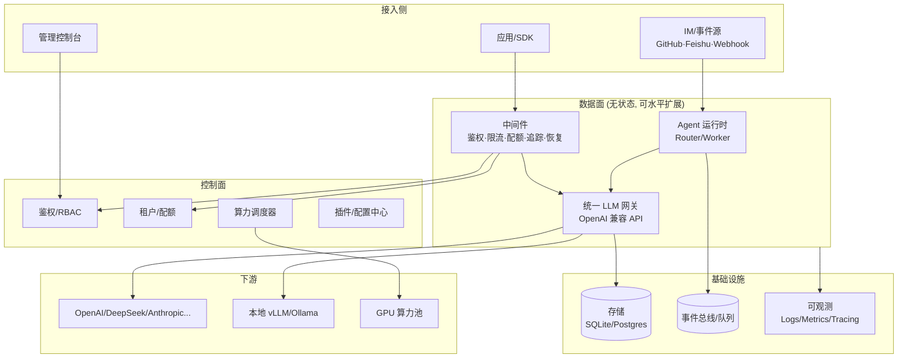
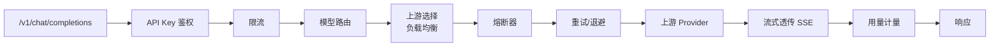

# Nexus 架构设计文档

> 统一 LLM 与算力服务平台 · 企业级自主 Agent 运行时
> 由 `deepseek-ai/dsh-superagent-prototype`（TypeScript 研究原型）以 Go 重写并升级为生产级平台。

## 1. 定位与目标

Nexus 是一个面向企业的**统一智能底座**，把三类能力收敛到一个平台：

1. **统一 LLM 服务（Gateway）**：以一套 OpenAI 兼容 API 接入异构模型供应商（OpenAI、DeepSeek、Anthropic、Azure、Gemini、本地 vLLM/Ollama 等），对上提供统一入口，对下屏蔽差异，解决密钥分散、重复对接、故障无法切换、成本不可见的问题。
2. **算力服务（Compute）**：把推理后端（GPU 实例、推理引擎、自建集群）抽象为算力池，统一进行配额、调度、弹性与健康管理。
3. **自主 Agent 运行时（Agent Runtime）**：继承 dsh-superagent 的双层 Router/Worker 架构、事件驱动与插件化思想，让 Agent 可长期在线、上下文隔离、异常自愈。

设计目标（对应原项目四特征并强化为企业级 SLO）：

| 维度 | 目标 |
| --- | --- |
| 高性能 | 单实例万级并发连接；网关转发低开销；流式首 token 延迟接近直连 |
| 高可用 | 无状态数据面可水平扩展；故障转移、熔断、重试、优雅关停、崩溃自愈 |
| 可扩展 | 一切供应商、算力后端、Agent 工具、事件源均为插件，接口稳定 |
| 多租户 | 租户/项目/API Key 三级隔离，独立配额、限流与计量 |
| 可观测 | 结构化日志 + Prometheus 指标 + OpenTelemetry 追踪，全链路可审计 |
| 安全 | 最小权限、密钥加密、凭据不进模型上下文、RBAC、审计留痕 |

## 2. 与原项目的映射

原项目的领域概念与工程纪律在 Nexus 中完整保留，仅替换实现语言并补齐生产化能力。

| dsh-superagent（TS/Cordis） | Nexus（Go） | 说明 |
| --- | --- | --- |
| Main Session（Router，轻模型） | `internal/agent/router` | 常驻全局路由，只做交互与分派，不陷入任务细节 |
| Executor Session（Worker，强模型） | `internal/agent/worker` | 上下文隔离、挂全套工具，不直接对用户说话 |
| Source / Trigger / Thread | `internal/agent/domain` | 事件源、不可变事件、时序线程 |
| Eval（Gate + Assessment） | `internal/agent/eval` | 确定性准入 + 模型研判两层 |
| Ticket / Mandate / Assignment | `internal/agent/domain` | 工单、授权、派工 |
| Engine（单一写入者、事务） | `internal/agent/engine` | 每个聚合只有一个 writer，命令在事务内完成 |
| Repositories（端口） | `internal/store` | 存储接口，内存/SQLite/Postgres 可替换 |
| Effects（持久副作用队列） | `internal/agent/effects` | 事务内入队、提交后执行、退避重试 |
| Outbox（发件箱） | `internal/store/outbox` | 至少一次投递，幂等去重 |
| Policy | `internal/agent/policy` | 版本化规则，变更不撤销已授 Mandate |
| Watchdog | `internal/agent/watchdog` | 健康探测、卡死检测、自动恢复 |
| Source 插件（GitHub/Feishu） | `internal/agent/plugin` | 统一插件注册协议 |

原项目核心纪律被继承：**显式窄依赖、一个状态一个写入者、命令用祈使语气/事实用过去时、Session 是实现细节而非用户负担、占用最少人类注意力**。

## 3. 总体架构



### 分层职责（六边形/端口-适配器）

- **接入层（server/api）**：HTTP、SSE、WebSocket 协议处理，中间件，请求校验，不包含业务规则。
- **领域层（agent/domain、gateway）**：纯业务逻辑与端口接口，不依赖具体框架与驱动，可独立单测。
- **端口层（store、provider、compute 接口）**：定义外部边界的抽象契约。
- **适配器层（provider 实现、store 驱动、插件）**：对接具体供应商、数据库、事件源。
- **平台层（auth、tenant、observability、config）**：横切的企业能力。

依赖方向始终向内：外层依赖内层，内层通过端口接口反向定义需求，不感知具体适配器。

## 4. 核心子系统设计

### 4.1 统一 LLM 网关（第一阶段交付重点）



关键机制：

- **Provider 抽象**：定义统一 `Provider` 接口；通用 OpenAI 兼容适配器可对接任意遵循 OpenAI Chat 协议的端点（OpenAI、DeepSeek、vLLM、Ollama、各类代理），Anthropic/Gemini 等异构协议通过独立适配器做请求/响应字段映射。
- **模型路由**：按 `model` 名称逻辑寻址，一个模型可映射到多个等价上游（channel group），支持按能力、标签、成本、租户策略路由。
- **负载均衡**：加权轮询、最少连接、随机；结合主动/被动健康检查，故障节点自动摘除。
- **韧性三件套**：
  - 令牌桶限流（按租户/Key/模型维度）；
  - 熔断器（关闭/打开/半开三态，错误率与连续失败触发）；
  - 重试 + 指数退避（仅对幂等读取与可安全重试的状态码 408/429/5xx，流式已产出后不重试）。
- **流式透传**：SSE 全双工转发，使用 `http.Flusher` 边收边发，不缓冲整包，降低首 token 延迟；自动处理心跳与断连。
- **计量计费**：按 token（prompt/completion）、模型、租户、Key 记录用量与成本，支持预算上限与告警。
- **密钥管理**：平台 API Key 哈希存储；上游密钥加密保存，仅在调用时解密，不进入日志与模型上下文。

### 4.2 算力调度（后续阶段）

- **算力池**：把 GPU 节点、推理引擎实例、Serverless 端点注册为可调度单元，上报显存、并发、吞吐、健康度。
- **调度器**：基于配额、优先级、亲和性、SLA 进行排队与放置；支持抢占、弹性伸缩、按利用率自动扩缩。
- **配额体系**：租户级配额（QPS、并发、token 预算、显存/卡时），与网关限流联动。

### 4.3 Agent 运行时（后续阶段）

- **双层架构**：Router 用轻量模型常驻分派，Worker 用强模型在隔离会话与目录执行；Worker 可直接订阅后续事件（直通），避免绕回 Router。
- **事件驱动**：事件经 Fast Path（规则过滤大部分噪音）/ Slow Path（LLM 研判候选）；支持批处理，单轮合并积压事件以摊薄推理成本。
- **上下文管理**：上下文窗口当缓存管，Inline & Spill 决定保留与换出；链式召回（Chain of Recall）按 ID 引用图多跳展开。
- **存算分离**：无状态 harness 按需创建执行环境，支持 BYOM（自带机器）与云端托管；端侧轻量 daemon 只执行命令、不存状态。
- **Watchdog**：检测卡死、超时、失联，自动重试/重启/升级，失败按结构化事实上报，不依赖自由文本推断。

### 4.4 企业平台能力

- **鉴权与多租户**：API Key（数据面）+ JWT（管理面）+ RBAC；租户资源逻辑隔离。
- **可观测**：`slog` 结构化日志；自实现 Prometheus 指标（QPS、延迟、错误率、token、上游健康、熔断状态）；预留 OTel 追踪接口。
- **配置**：YAML + 环境变量，校验前置，支持热加载（数据面无状态，配置变更通过控制面下发）。
- **可靠投递**：Outbox + 持久 Effects 队列保证至少一次，幂等键去重，指数退避，优雅关停排空在途请求。

## 5. 关键技术决策

| 决策 | 选择 | 理由 |
| --- | --- | --- |
| 语言 | Go | IO 密集高并发，goroutine 与网络生态成熟，单二进制易部署，交付效率高 |
| HTTP 框架 | 标准库 `net/http` + `ServeMux` | 1.22+ 原生方法/路径模式，零重依赖，性能高、可控 |
| 日志 | 标准库 `log/slog` | 结构化、零依赖、级别与上下文感知 |
| 韧性组件 | 自实现（限流/熔断/负载均衡） | 逻辑可控、无重依赖、便于针对 LLM 场景定制 |
| 指标 | 自实现 Prometheus 文本格式 | 零依赖即可被 Prometheus 抓取，后续可换 OTel |
| 存储 | 端口接口 + 内存实现起步 | 保证开箱即编译运行；SQLite/Postgres 作为可替换适配器 |
| 配置 | `gopkg.in/yaml.v3` | 企业通用、可读性好 |

## 6. 目录结构

```
nexus/
├── cmd/nexus/            # 程序入口 main
├── internal/
│   ├── config/           # 配置模型、加载与校验
│   ├── logging/          # slog 日志初始化
│   ├── server/           # HTTP server、中间件、优雅关停
│   ├── gateway/          # 统一 LLM 网关：provider/路由/负载均衡/熔断/重试/限流/handler
│   ├── sse/              # SSE 流式读写工具
│   ├── auth/             # API Key 鉴权
│   ├── tenant/           # 租户与配额
│   ├── store/            # 存储端口与内存实现
│   ├── metrics/          # Prometheus 指标
│   ├── id/               # ID 生成
│   └── backoff/          # 指数退避
├── configs/              # 示例配置
├── deploy/               # Dockerfile / docker-compose / k8s
└── docs/                 # 架构与设计文档
```

## 7. 演进路线

- **阶段一（当前）**：可编译运行的工程骨架 + 统一 LLM 网关核心链路——OpenAI 兼容 Chat/SSE 转发、多上游负载均衡、健康检查、重试、熔断、限流、API Key 鉴权、租户计量、Prometheus 指标、健康检查、优雅关停、Docker 化。
- **阶段二**：Agent 运行时——domain 模型、引擎、Router/Worker、事件总线、Effects/Outbox、插件协议。
- **阶段三**：算力调度——算力池、调度器、配额、弹性伸缩。
- **阶段四**：生产化加固——Postgres/SQLite 持久化、密钥加密、JWT/RBAC、管理控制台、OTel 全链路追踪、高可用部署与压测。
